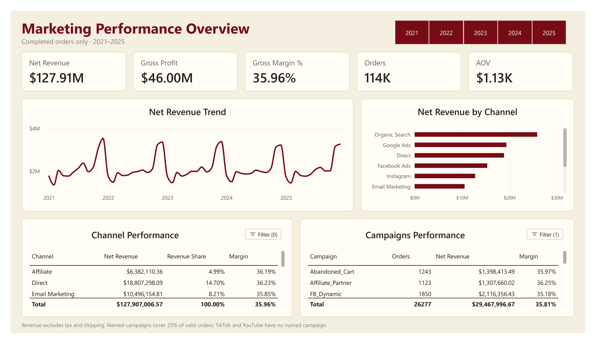
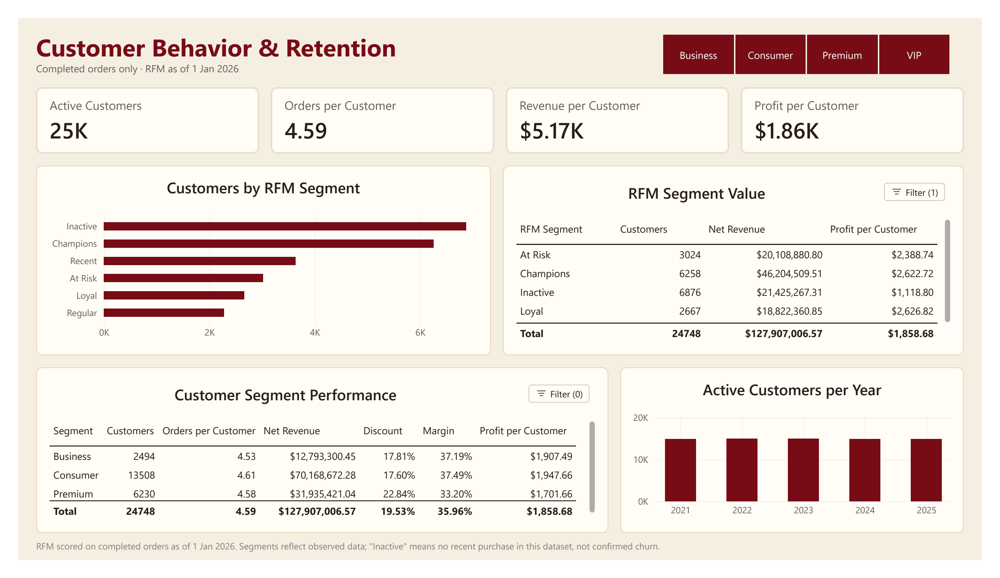
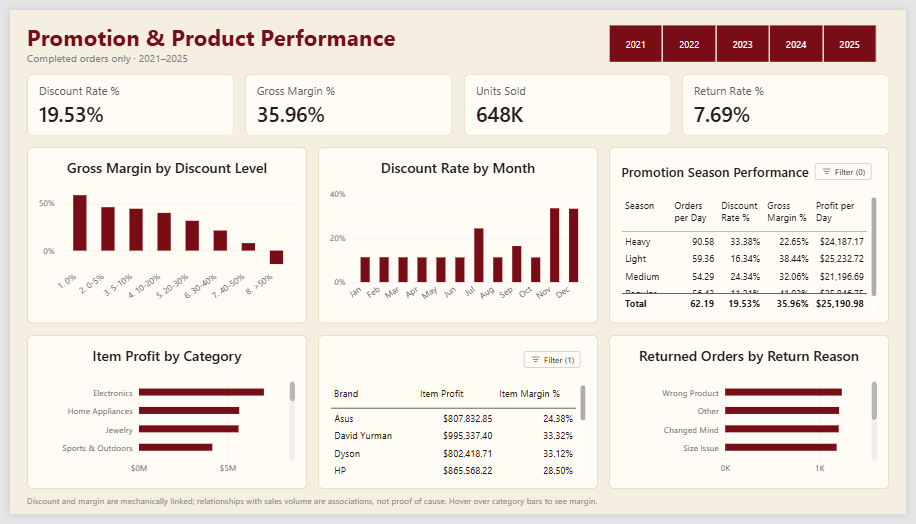

## Project Overview

This project analyzes five years of e-commerce order data (January 2021 to December 2025) to understand how marketing channels, customer segments, promotions, and products contribute to profit, not just revenue. The workflow runs from Python to MySQL to Power BI.

The analysis was built around six business questions:

1. Which marketing channels and campaigns contribute the most to sales and profit?
2. Does the channel with the highest revenue also generate the highest profit?
3. Which customer segments are the most valuable?
4. What are the purchasing and repeat purchase patterns?
5. Do discounts and coupons support sales, or do they reduce profitability?
6. Which products, brands, and categories contribute the most to profit?

Along the way, the dataset's existing figures were reviewed instead of being taken at face value, and several of them turned out to be misleading.

## Dataset

The dataset covers January 1, 2021 to December 31, 2025 in five files: orders (138,116 rows), order items (397,569 rows), customers (25,000 rows), products (1,175 rows), and one summary file.

The data comes from the [E-Commerce Sales Analytics Dataset](https://www.kaggle.com/datasets/datascikhan/e-commerce-sales-and-customer-analytics) on Kaggle, published by datascikhan.

The raw data is not shared because it contains personal information. Names, cities, postal codes, and review text were removed before the analysis. Missing values appeared only in the orders table and carried business meaning, for example an empty return field means the order was not returned, so no values were imputed.

## Data Verification

Before using the data, each assumption from the dataset description was tested. Several turned out to be wrong, and each one changed how the analysis was done.

| Assumption | What verification showed | Decision |
| --- | --- | --- |
| `net_sales` is revenue | It already includes tax and shipping | Net revenue was recalculated as gross sales minus discount |
| `profit` is actual profit | It includes tax, which makes up 22.2% of the reported profit | Gross profit is net revenue minus product cost |
| Every order is a sale | 17.8% of orders were not Completed (Returned 6.9%, Cancelled 6.1%, Pending 4.8%) | Valid sales are Completed orders only |
| Orders and order items agree | 11,226 orders (8.1%) could not be reconciled | Affected rows were flagged, and product analysis uses matched rows only |
| Lifetime value and acquisition cost are usable | Lifetime value came from a larger dataset than the files provided, and acquisition cost was not tied to channel or customer value | Neither was used; customers were segmented independently with RFM |
| All campaigns can be compared | 60% of orders have no campaign tag and 17% carry a default tag | Only named campaigns (23% of orders) were compared |

## Methodology

- **Python (Google Colab):** inspected every file, checked keys, relationships, and monetary column definitions, explored distributions and seasonality, and cleaned copies of the data while leaving the source files untouched. Revenue, profit, discount, and order-status fields were redefined, and the cleaned files were validated against the originals (row counts unchanged, valid sales revenue matching exactly).
- **MySQL 8.0:** created a schema with four tables (customers, products, orders, and order items) with primary and foreign keys, loaded the cleaned data, and re-validated every total. Business metrics were calculated with aggregation, CTEs, and window functions such as `LAG`, `RANK`, and `NTILE`. Customers were segmented with RFM using a fixed reference date, and three views centralized the business definitions for the dashboard.
- **Power BI:** a direct connection to MySQL did not work on the author's device, so the three SQL views were exported to CSV and imported. The model uses a DAX-generated date table and one-to-many relationships, with the main measures (net revenue, gross profit, gross margin, average order value, discount rate, return rate) written in DAX on top of Completed orders. Every dashboard figure was reconciled with the SQL results.

## Dashboard

The dashboard has three pages, and each page carries a footnote about the relevant data limitations.

_Marketing Performance Overview: which channels contribute the most, and does higher revenue translate into higher profit?_

_Customer Behavior & Retention: which customers are the most valuable, and how do customer groups differ?_

_Promotion & Product Performance: do discounts preserve profitability, and which products contribute the most?_

## Key Findings

- **Revenue does not necessarily reflect profitability.** Each channel's revenue contribution largely followed its order volume (Organic Search 20.2%, Google Ads 15.1%, Direct 14.7%), and margins were nearly identical across channels (35.7% to 36.2%).
- **Discounts can quickly erode profit.** Margin fell from 45.9% for orders with discounts below 5% to −14.3% for orders with discounts above 50%, with a break-even point at roughly a 48% discount. Orders with discounts above 40% were only 6.1% of all orders but accounted for almost all loss-making orders.
- **Higher promotions increased sales, but not profit.** In November and December, with discounts averaging around 33%, orders per day rose from 56.4 to 90.6 and daily revenue increased by about 73%, while daily profit fell by about 7%.
- **VIP and Premium customers were not necessarily more valuable.** Their purchase frequency and spending were similar to other segments, but they received deeper discounts (22.8% against 17.6%), so profit per customer was about 12% lower.
- **Coupon usage had no measurable impact** on discount levels, order value, or margin. The discount rate was 19.53% with and without coupons.
- **Customer value was concentrated.** In the RFM segmentation, Champions (25% of customers) contributed 36% of revenue, while the 3,024 At Risk customers had high value but had not ordered for a long time.
- **Electronics carried less profit than its sales suggest.** It contributed 21.6% of revenue but only 15.3% of profit, with a margin of 25.4%, while Grocery and Books had margins above 50% but smaller contributions.

## Recommendations

These recommendations are hypotheses to test, not proven cause-and-effect relationships.

1. Set discount limits at around 40%, since the break-even point is about 48%.
2. Test smaller discounts in July and in the November to December promotional period, then compare the resulting profit.
3. Review discount policies for VIP and Premium customers and consider non-price benefits instead.
4. Run win-back campaigns for At Risk customers.
5. Avoid allocating marketing budgets based on revenue contribution alone. Start tracking campaign costs, impressions, and clicks, and make sure every campaign is tagged.
6. Improve Electronics margins through pricing, purchasing costs, or product bundling.

## Limitations

- Campaign cost, impression, and click data were not available, so ROAS, CPA, and conversion rate could not be calculated.
- There was no control group, so relationships such as discounts and sales are associations, not evidence of causation.
- About 8% of orders were missing from the dataset, so customer metrics are based on the order history that was available.
- Valid sales were defined as Completed orders, although about 10% of them still had a Pending payment status.
- Discount seasons were derived from observed patterns in the data, not from an official promotional calendar.
- Several variables, including channel, coupon usage, purchase time, and purchase day, showed no observable relationship with the outcomes. These results are reported as they are.