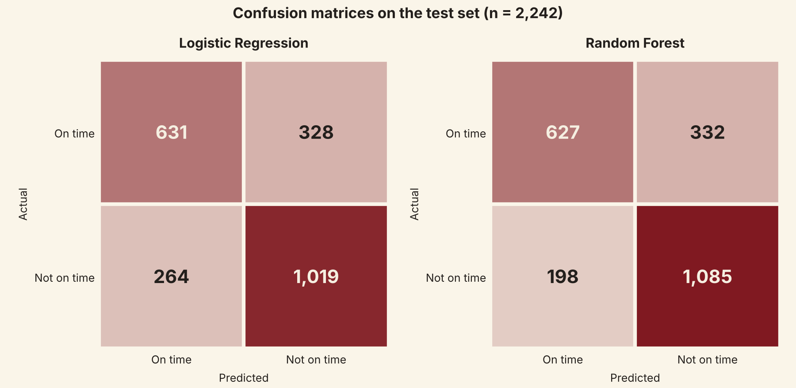

## Project Overview

This undergraduate thesis uses the Knowledge Discovery in Databases (KDD) framework to identify the academic and non-academic factors that influence whether students graduate on time. It applies Logistic Regression and Random Forest to classify on-time graduation, defined as a study duration of four years or less, and compares the two models to find the better one.

The predictors cover academic, demographic, economic, and institutional aspects. The resulting model is intended as a basis for an academic monitoring system and as input for academic policy.

The dataset consists of confidential institutional academic records, so the data, code, and thesis document are not publicly shared. This page covers the methodology and aggregate results only.

## Dataset

The raw dataset contains 61,031 records with 25 attributes. Graduation date, final GPA, and later-semester GPA had many missing values because many students had not yet graduated or reached those semesters.

Only students with a graduated status and valid dates were labeled, which gives 11,206 records. The model uses 10 features: gender, tuition tier (UKT), province, study program, and the GPA of semesters 1 to 6 (7 numeric and 3 categorical). Final cumulative GPA and semester 7 to 8 data were deliberately excluded. This simulates a monitoring system that evaluates progress before the final stage of study, instead of using information that only exists after graduation.

The classes are imbalanced. In the test set, 959 students (42.8%) graduated on time and 1,283 (57.2%) did not.

## Methodology

- **Data cleaning:** trimmed column names, removed hidden characters and double spaces, and stripped text fields to avoid duplicate pseudo-categories.
- **Province standardization:** removed the "Prov." prefix with a regular expression, applied title case, unified inconsistent spellings with a mapping table, and removed overseas students to keep the population homogeneous.
- **GPA feature engineering:** converted GPA columns to numeric values (values outside 0 to 4 became missing) and restructured calendar-year columns into chronological semester 1 to 6 columns based on each student's entry year, because the same calendar year is a different semester for each cohort.
- **Target label:** study duration is the graduation date minus the entry date, divided by 365.25. Students finishing in four years or less are labeled On Time, and the rest Not On Time.
- **Exploratory analysis:** distributions of cohort, gender, graduation status, and the top 15 provinces; GPA boxplots for semesters 1 to 6; a correlation heatmap; the target distribution; and target proportions by gender and tuition tier.
- **Train-test split:** an 80:20 stratified split (8,964 training and 2,242 test records, random_state=42), done before any imputation or encoding to prevent data leakage.
- **Preprocessing pipeline, fitted on training data only:** numeric features use median imputation (chosen over the mean because academic data contains outliers) and standard scaling. Categorical features use most-frequent imputation and one-hot encoding that ignores unseen categories. Both are combined with a ColumnTransformer inside a scikit-learn Pipeline for each model.
- **Modeling:** Logistic Regression and Random Forest were trained on the same training set.
- **Evaluation and selection:** accuracy, precision, recall, and F1-score for the On Time class, ROC-AUC, and confusion matrices. The models were compared on accuracy, F1, and ROC-AUC, and the winner was interpreted with Gini feature importance.

## Results

Random Forest outperformed Logistic Regression on accuracy, F1-score, and ROC-AUC on the test set of 2,242 students.

| Metric | Logistic Regression | Random Forest |
| --- | --- | --- |
| Accuracy | 73.60% | 76.36% |
| ROC-AUC | 0.8051 | 0.8369 |
| F1-score (On Time) | 0.68 | 0.70 |
| Precision (On Time) | 0.71 | 0.76 |
| Recall (On Time) | 0.66 | 0.65 |

Random Forest was noticeably more precise for the On Time class (0.76 against 0.71), while recall was similar for both models (0.66 and 0.65).

_Confusion matrices on the 2,242 test records (rows are actual outcomes, columns are predicted outcomes)._

## Key Findings

- Academic performance dominated. All six semester GPAs were the six most important features, led by Semester 6 (Gini importance 0.129).
- First-year GPA (semesters 1 and 2) also ranked high, which points to an early-warning pattern.
- Tuition tier was the strongest non-academic factor (rank 7, importance 0.082).
- Study program, province, and gender each contributed far less, with importance below 0.015.

## Limitations & Future Work

- The classes are imbalanced, with Not On Time as the larger class.
- Only students who had already graduated could be labeled, so students who had not yet graduated were left out of the analysis.
- From the thesis, future work includes adding behavioral data such as Learning Management System activity or attendance, applying survival analysis to use data from students who have not yet graduated, and testing models better suited to imbalanced data, such as XGBoost or LightGBM.