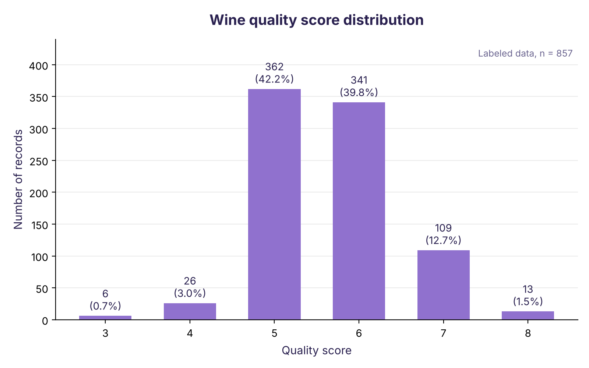
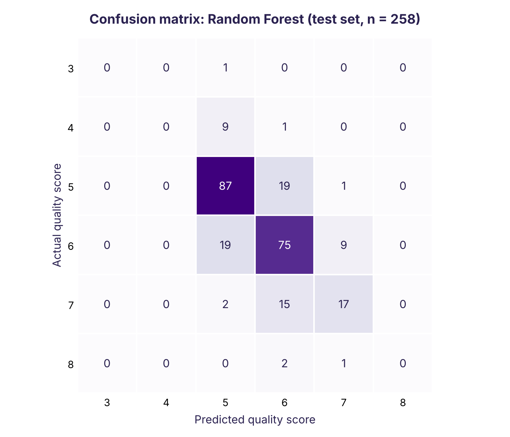

## Project Overview

This project was completed as the midterm examination for a Data Mining course. The goal was to classify the quality score of wine from its physicochemical properties using a Random Forest classifier, covering data understanding, outlier checks, exploratory analysis, model training, and evaluation.

## Dataset

The data was provided by the course instructor and appears to be derived from the publicly available Wine Quality dataset (Cortez et al., 2009). It contains 857 labeled records with 11 numeric features: fixed acidity, volatile acidity, citric acid, residual sugar, chlorides, free sulfur dioxide, total sulfur dioxide, density, pH, sulphates, and alcohol. The target is a quality score from 3 to 8, and there are no missing values.

The classes are strongly imbalanced: scores of 5 (42.2%) and 6 (39.8%) make up most of the data, followed by 7 (12.7%), 4 (3.0%), 8 (1.5%), and 3 (0.7%).

_Distribution of quality scores in the labeled data._

## Methodology

- **Data checks:** reviewed data types, missing values, and descriptive statistics.
- **Outliers:** inspected every feature with boxplots and tested Z-score filtering. Because outliers remained after filtering and reflect natural variation in the chemistry data, they were kept.
- **Exploratory analysis:** compared feature distributions across quality levels with box plots and violin plots, and examined a correlation heatmap.
- **Modeling:** split the data 70/30 into 599 training and 258 test records, then trained a Random Forest classifier with 100 trees.
- **Evaluation:** accuracy, weighted precision, recall, and F1-score, a confusion matrix, and a multiclass ROC curve (one-vs-rest).
- **Final step:** saved the trained model and applied it to a separate unlabeled test file to produce quality predictions.

## Key Findings

- Alcohol and sulphates showed the strongest positive relationship with quality, while volatile acidity showed a clear negative relationship.
- Residual sugar and both sulfur dioxide measures showed weak or inconsistent relationships with quality.

## Results

The model reached an accuracy of 69.4% on the hold-out test set, with a weighted precision of 65.3%, recall of 69.4%, and F1-score of 67.2%. The macro-average ROC-AUC was 0.828, with per-class values between 0.66 and 0.89.

Most errors occurred between neighboring quality levels (5 and 6, and 6 and 7), which share similar chemical profiles.

_Confusion matrix on the 258 test records (rows are actual scores, columns are predicted scores)._

## Limitations & Future Improvements

- The model did not correctly predict the rarest classes (scores 3, 4, and 8), so overall accuracy mainly reflects performance on scores 5 and 6.
- Class imbalance was identified but not addressed, and the evaluation used a single train/test split without cross-validation or hyperparameter tuning.
- Possible improvements include class weighting or resampling, stratified cross-validation, and hyperparameter tuning.